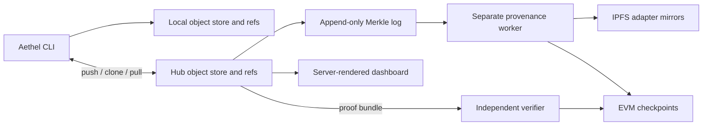

# Architecture and low-level design

Course UE23CS441A, Team 91.
Technical reference updated 14 October 2026. See the [supported scope](README.md),
[user guide](guide.md), and [measured evidence](evidence/README.md).

## Layers and data flow



| Layer | Modules | Responsibility |
|---|---|---|
| Core | [aethel/core](../aethel/core/) | Hashing, object storage, commits, refs, locks, workspace replacement, Merkle arithmetic |
| Commands | [aethel/commands](../aethel/commands/) | Argument parsing, orchestration, error rendering |
| Evaluation | [aethel/evaluation](../aethel/evaluation/) | Dataset manifests, held-out partitions, inference, metrics, comparison context |
| Adapter comparison | [aethel/ml/diff.py](../aethel/ml/diff.py) | Effective standard-LoRA update comparison |
| Remote | [aethel/remote](../aethel/remote/) | Push planning, HTTP transport, verified clone/pull |
| Hub | [hub](../hub/) | Publication, log, API, dashboard, background status probes |
| Provenance | [aethel/provenance](../aethel/provenance/) | IPFS retrieval, checkpoint jobs, chain verification |
| Contract | [AethelCheckpoint.sol](../contracts/AethelCheckpoint.sol) | Owned, increasing checkpoint sequence and two-step ownership transfer |

Core uses the standard library, raises domain errors, and does not print. The command boundary
renders errors. Hub code reuses core primitives; ordinary client versioning/retrieval does not
require FastAPI. ML dependencies are loaded only by the operations that need them. Signing and
pinning credentials belong to a separate worker rather than the web server.

## Object store and refs

```text
.aethel/
  config.json                  schema version, pinned base, author, optional saved Hub URL/name
  HEAD                         ref: refs/heads/<branch>, or a detached commit digest
  refs/heads/<branch>           current commit digest; empty for an unborn branch
  objects/
    blobs/<ab>/<rest>          raw artifact bytes
    trees/<ab>/<rest>          filename-to-blob mapping
    commits/<ab>/<rest>        snapshot metadata and parent
    bases/<ab>/<rest>          model ID and immutable revision reference
  workspace/                   staged adapter artifacts
```

An object's path contains its SHA-256 digest, split after two hex characters. Two snapshots
with identical weights share a blob but retain separate commit metadata. There is no database
needed to reconstruct local history. A Hub has a separate object store plus `repos.json`,
`log.jsonl`, `anchors.jsonl`, and worker state in `provenance.sqlite3`.

Local JSON writers use sorted keys, compact separators, UTF-8, and no NaN/Infinity. Hashing
received objects uses their **exact bytes**, including whitespace; downloads must not parse and
reserialize JSON before installation. Verified raw downloads preserve noncanonical JSON too.

A tree is a JSON mapping with a `files` field. Filenames must be nonempty single components;
path separators, colons, NUL, `.` and `..` are rejected. Extraction verifies all source blobs
before replacement and verifies each copied file against its digest.

A schema-2 commit contains:

```json
{
  "schema": 2,
  "parent_hash": null,
  "tree": "<tree digest>",
  "adapter_blob": "<adapter digest>",
  "base": "<base digest>",
  "message": "SST-2 baseline",
  "author": "Team member",
  "timestamp": "<ISO-8601 timestamp>",
  "training_info": {}
}
```

A parent is null or a valid digest. Tree, adapter, and base references must be valid and
present. The adapter digest must agree with the preferred adapter entry in the tree:
`adapter_model.safetensors`, then legacy `adapter_model.bin`. Safetensors is used for supported
adapter comparison; arbitrary legacy pickle weights must not be treated as safe to load.
Message, author, and timestamp fields are strings; training information is a mapping. Base
objects record `model_id` and `revision_sha`, with schema/source metadata from local writers.

Refs are separate mutable files. Branch names reject path syntax, whitespace, hidden-name
forms, trailing dots, lock suffixes, and reserved Windows names. Full hashes and unique short
hashes can identify commits. Checking out a hash detaches HEAD; committing requires an attached
branch. Schema 2 has one parent and does not implement merges.

## Persistent records and protocol objects

| Record | Identity and contents |
|---|---|
| Local `config.json` | `schema_version`, `model_id`, `revision_sha`, `author`; optional `hub_url` and `hub_repo` |
| Base object | Schema/source metadata, model ID, immutable revision; no model weights |
| Tree object | `files`: a filename-to-blob-digest mapping |
| Training metadata | Effective settings, initialization, input manifest, environment, metrics and evaluation context |
| Dataset manifest | `schema`, `algorithm`, `dataset_file`, raw/example hashes, counts, column names, label IDs, seed, fractions and exact `splits` indices |
| Evaluation specification | Model revision, dataset and split identity, labels, token length and sample count; hashed for comparison identity |
| Hub repository index | Repository name, branch tips and timestamps; separate from content-addressed objects |
| Log entry | Accepted commit digest, stable index and timestamp; its leaf is derived from the commit digest |
| Inclusion proof | `commit_hash`, `leaf_index`, `log_size`, `root`, and ordered `{sibling, side}` steps |
| Checkpoint bundle | `checkpoint`, `proof`, and ordered prefix `leaves`; the verifier supplies chain trust separately |
| On-chain checkpoint | Root, block number, predecessor size, indexed by log size under one contract log ID |
| Worker state | SQLite `records(kind, key, payload)` with a composite primary key and update timestamp |

The worker database uses WAL journaling and `synchronous=FULL`. JSON payloads hold mirror and
checkpoint jobs, including retry information; this database is operational state, not an index
needed to read a local adapter repository. The CLI `provenance status` exposes persisted job
records without printing credentials. Backups need a coherent database/object/ref/log snapshot.

Ordinary Merkle membership and checkpoint-bundle verification are distinct. The bundle verifier
requires the expected leaf at its exact index, validates the path shape for the stated size,
rejects missing or extra proof steps and duplicate prefix commits, reconstructs the prefix root,
and delegates chain/code/log-identity checks to the independently configured chain client.

## Commit and workspace replacement

Commit creation reads the staged adapter, verifies the base and evaluation bindings, stores
blobs/tree/commit, and advances the branch last. The final ref write compares the expected
branch and parent under the shared ref lock. Concurrent evaluation or ref changes cannot
silently attach a commit to a different parent. Snapshotting does not clear the workspace.

Training and checkout build a replacement in a temporary directory. Under `workspace.lock`,
the old workspace is hashed, the replacement is prepared, and the original is checked again
before installation. The old directory becomes `workspace.backup`; installation or ref-write
failure restores it. Pull uses the same mechanism with an exact clean-workspace requirement,
including deleted files. Process termination can leave a backup/lock requiring inspection.

Object/ref writes use exclusive random temporary filenames on the destination filesystem,
flush contents, atomically rename, and flush the parent directory where supported. Streamed
copies hash the bytes actually copied before installation, preventing a source changing between
the initial hash and copy from being stored under the wrong name.

`fsck` re-hashes stored objects, validates dependencies and the adapter/tree relationship, and
checks reachability from branches and detached HEAD. Unreachable objects can result from an
interrupted write; they are reported, not automatically deleted. Corruption needs a verified
original copy. Verified writes and transfers can repair corrupt cached objects.

## Publishing and retrieval

### Push

1. Walk every ancestor of the chosen tip locally and build the complete object plan.
2. Ask the Hub which objects it lacks. The Hub checks hashes, so corruption is a miss.
3. Send missing blobs, trees, bases, then commits in dependency order, preserving stored bytes.
4. Publish the ref with the previously observed remote tip. The Hub revalidates all history,
   checks fast-forward ancestry and concurrency, appends accepted log entries, then saves the ref.

An accepted ancestor is not exempt from dependency validation on later publication. Display
history limits do not shorten completeness checks. A repeated push reuses existing log entries.
The log and ref are separate files: an append can succeed before ref persistence fails, leaving
accepted entries without that branch pointing to them. Retry reuses those entries; this is not
an atomic transaction across the entire Hub.

### Clone and pull

`HubClient.repository` captures one branch-tip snapshot. The raw route
`GET /api/v1/objects/{kind}/{object_hash}` streams exact bytes with a digest header. JSON
inspection routes remain useful for display but cannot reconstruct every original hash.
`HistoryDownload` iteratively walks parents, validates commit shape, tree paths, every blob,
the base, and the adapter/tree relationship. Received bytes land in unique temporary files,
are size-bounded and hashed, and are installed only after matching the requested digest.
Existing valid objects are reused; corrupt cached objects can be replaced by verified bytes.

Clone reserves a **new destination** exclusively and builds inside an owned temporary directory.
After validating all published branches and a consistent pinned base, it restores the chosen
tree and installs `.aethel`. It selects `main`, otherwise the only branch, otherwise requires
an explicit branch. Failed cleanup removes owned temporary content and removes the destination
only if empty. Concurrent unrelated files are preserved. Saved settings contain the Hub URL,
repository name, and local author, not a token.

Pull captures the current attached branch and local tip, retrieves the corresponding remote
history, and checks the pinned base. Equal tips or a locally ahead branch are no-ops. Divergence
is refused. A fast-forward requires a clean workspace, stages the new tree, then installs with
a ref-update callback that checks the captured HEAD/tip under the ref lock. Callback failure
rolls back the workspace. Verified objects survive failed pulls for reuse. A remote growing
after the initial snapshot is picked up on the next pull.

| Retrieval bound | Limit |
|---|---|
| Repository response | 1 MiB |
| Structured object | 16 MiB |
| Blob | 64 MiB |
| Reachable object bytes | 4 GiB, including cached objects |
| Restored workspace | 4 GiB, counting repeated blobs once per filename |
| Objects / commits | 100,000 / 10,000 |

These limits bound resource use during retrieval. The Hub's upload cap is separately
configured and defaults to 64 MiB for both blobs and structured objects.

## Training and held-out evaluation

Training initializes a fresh adapter from the pinned base. Version-history parents describe
snapshot lineage, not proof of training initialization from the parent adapter. Recorded
metadata includes initialization, target modules, settings, model revision, environment,
dataset identity, and whether synthetic data was used.

The `stratified-unique-text-v1` manifest records raw input and canonical-example hashes, column
names, label IDs, sample selection, split seed, and exact train/validation/test indices.
Whitespace/case-normalized duplicate text is removed; conflicting labels fail. Each class
needs at least three unique examples. `seed` controls training and `split_seed` controls data
partitions, so repeated runs can vary initialization without changing the held-out comparison.

The dataset path is relative to the repository root when the file is inside it; external paths
can be absolute. Evaluation reconstructs the recorded manifest and rejects altered inputs or
split membership. Raw-byte and canonical-example hashes serve different purposes: formatting
changes may preserve parsed examples while still changing the raw file hash.

Evaluation records accuracy, loss, macro-F1, support/confusion data, sample count, and hashes of
the adapter, adapter config, and training metadata. A specification binds model revision,
dataset/split identity, label meanings, token length, and sample count. Parent comparisons use
one compatible specification; unrelated metric contexts cannot establish improvement. Loss
is weighted by examples, including a final partial batch; macro-F1 includes configured classes.
Non-finite model outputs fail explicitly.

Validation supports development; test results are explicitly requested for final reporting.
Dataset manifests prevent accidental input drift, not dishonest input declarations or all
semantic overlap between datasets. Reproduction still needs the original dataset, pinned base,
and a compatible environment.

## Effective adapter comparison

For supported standard LoRA, a layer update is:

```text
Delta W = (alpha / rank) * B @ A
```

Comparing flattened factor vectors is misleading because rescaling A and inversely rescaling B
leaves the effective update unchanged. The implementation compares effective updates in row
blocks, reporting norms, distance, relative change, and cosine. Different ranks can represent
the same update; zero updates have no defined cosine. Saved classifier/module tensors are
reported separately. Unsupported PEFT variants and rank/alpha patterns are rejected rather
than interpreted with the wrong formula. Comparison is descriptive, not an automatic merge.

## Transparency log and checkpoints

Accepted commit digests form an ordered, append-only log. The Merkle algorithm uses domain
separation and promotes an odd last node unchanged:

```text
leaf = SHA256(0x00 || UTF8(commit_digest_hex))
node = SHA256(0x01 || UTF8(left_digest_hex + right_digest_hex))
```

The UTF-8 hexadecimal encoding is part of this protocol. Distinct leaf/node tags prevent an
internal node being reinterpreted as a leaf. Promotion avoids ambiguity caused by duplicating
odd nodes. A proof supplies sibling digests and their sides; independent checkpoint verification
also validates position and log size. Python and browser implementations have shared parity checks.

The non-upgradeable contract records increasing `(size, root, blockNumber, previousSize)`
checkpoints for one immutable log identity. Only the owner publishes; owner rotation requires
nomination and acceptance. The contract checks ordering/ownership, not the correctness of the
operator's data. A verifier reconstructs earlier prefixes to detect inconsistent history.

The worker validates accepted history before publication, persists signed transaction bytes
and hash **before broadcast**, and records receipts after required confirmation depth. Retry
reuses pending jobs and signed bytes. Independent verification checks the chosen chain ID,
exact deployed bytecode, log ID, checkpoint, confirmation depth, positional inclusion, and all
earlier checkpoint roots. Checks sample chain state and confirm the sampled block remains
canonical; stale cached success is not proof of present confirmation.

A proof bundle can be saved and verified without the Hub, but chain verification still needs
an independently chosen RPC/node. A self-consistent bundle from the Hub cannot choose its own
trust anchor. Bundle verification supports up to 100,000 leaves and 1,024 checkpoints.

## IPFS and the dashboard

IPFS mirrors contain adapter blobs only. Pinning records the CID before gateway verification,
so a failed download retries the same CID rather than creating another pin. Retrieval streams,
enforces bounds, checks SHA-256, and preserves an existing different destination. Provider URLs
are HTTPS except for allowed local development endpoints. Availability depends on the gateway
and pinning account; a CID is not a complete repository backup.

The dashboard uses Jinja templates, one stylesheet, and small JavaScript files for copy,
proof verification, and provenance refresh. It has no frontend framework or asset bundler.
Digests stay complete and copyable; their visual prefix emphasis does not truncate the value.
Fonts are self-hosted with their required licenses. Both themes, keyboard focus, reduced motion,
mobile overflow, Content Security Policy, escaping, and browser proof recomputation have tests.

Browser proof verification uses the portable SHA-256 implementation in
`hub/static/verify.js`, so it also works on plain HTTP over a local network where WebCrypto's
`crypto.subtle` is unavailable. Before checking a proof, it tests known hashes, SHA-256 padding
boundaries, and Aethel's leaf/node encodings. A failed self-test stops verification without
claiming the log was altered. The browser then checks the requested commit, folds the sibling
path, and compares the computed values with the page. The page and script still come from the
Hub; this checks internal consistency and does not authenticate an independently trusted root.

Status distinguishes unconfigured, pending, unavailable, stale, failed, and confirmed states.
A valid older checkpoint is distinguished from a newer unanchored log suffix. The `/api` prose
reference is checked against served routes, and `/openapi.json` remains available to tooling.
Server-side proof checking is a convenience; independent verification supplies its own trust.

## Concurrency and failure boundaries

| Lock | State protected |
|---|---|
| `.aethel/refs.lock` | HEAD, branch creation/deletion, checked tip updates |
| `.aethel/workspace.lock` | Training, checkout, and pull workspace replacement |
| `repos.lock` | Hub conflict checks, log acceptance, and ref index writes |
| `log.lock` | Append and consistent log snapshots |
| `anchors.lock` | Anchor records |
| `chain-worker.lock` | Signed transaction jobs and broadcast |
| `mirror-<digest>.lock` | One adapter's pin/retrieve cycle |

Locks use exclusive creation with a deadline. A killed process may leave a lock; automatic
removal could race a live owner, so recovery is explicit. Partial trailing JSONL records fail
closed and need inspection. Service shutdown and a coherent snapshot are the simplest backup
policy for this deployment. Detailed recovery actions live in [Operations](operations.md#retry-and-recovery-behavior).

| Threat or failure | Protection | Limit |
|---|---|---|
| Corrupt or substituted bytes | Content-addressed verification on read/write/transfer | The selected Hub can advertise a different internally valid history |
| Rewritten accepted history | Independently trusted checkpoints and prefix verification | RPC honesty and canonical-chain finality assumptions |
| Concurrent ref/workspace writers | Locks, expected-tip checks, staged rollback | Killed processes can require manual recovery |
| Forged metrics or authorship | Records bind claims to artifact bytes | No proof of honest training or real-world author identity |
| Web injection or credential exposure | Escaping, nonce CSP, validated external links, worker separation | Trusted deployment/configuration still matters |
| Oversized remote input | Bounded upload, retrieval, bundle, and graph sizes | Single-team scale; no production load claim |

## Validation pointers

Storage/ref/hash regression tests are `tests/test_core_*.py`; workspace and CLI preservation
are in `test_workspace_safety.py` and `test_cli_integrity.py`. Publication is covered by
`test_push.py` and `test_publication.py`; retrieval by `test_clone_pull.py`. Training, split
protocols, and adapter differences have dedicated tests. `test_provenance_*.py` exercises
mirrors and real contract execution on a local EVM. `test_hub_*.py` covers routes, rendering,
security, proof parity, and assets. See [Development](development.md#verification) for commands
and [Evidence](evidence/README.md#software-validation) for recorded results.

## Cost model and terminology

Object hashing/copying is linear in bytes processed. History validation visits reachable
commits and dependencies; deduplicated objects are reused within an operation. Building the
Merkle tree is linear in log length, while one membership proof has logarithmically many
siblings. Independent verification also checks the supplied prefix and earlier checkpoints,
so it does more work than a membership proof alone. These are algorithmic properties; no
production throughput or latency bound is claimed.

| Term | Meaning in Aethel |
|---|---|
| Adapter / base | Trainable low-rank patch / separately obtained frozen model |
| Content address | SHA-256 of the exact stored bytes |
| Commit / tree / blob | Snapshot metadata / file manifest / raw file contents |
| Ref / HEAD | Mutable branch tip / selected branch or detached commit |
| Workspace | Staged adapter files used by train, eval, commit and checkout |
| Fast-forward | A ref movement whose old tip is an ancestor of the new tip |
| Manifest / evaluation specification | Recorded input partition / context binding comparable measurements |
| Inclusion / checkpoint | Membership relative to a root / externally recorded prefix root |
| CID | IPFS content identifier; Aethel also checks the adapter's expected SHA-256 |
| Confirmation | A chain-depth observation at a sampled canonical state, subject to reorganization |
